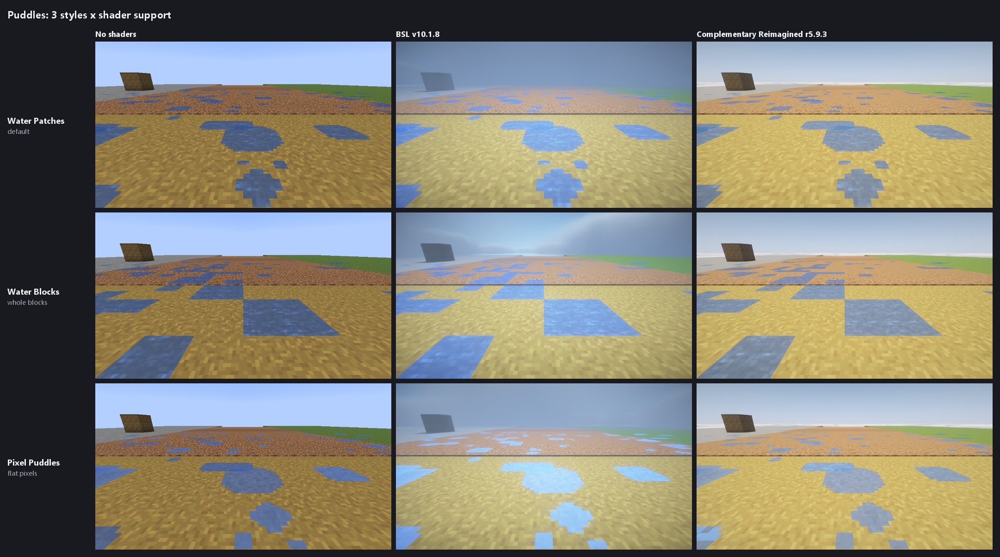

# Puddles

A client-side Fabric mod for Minecraft 26.3. When it rains, puddles form on the ground, ripple under the raindrops, splash when you walk through them, and dry up again once the weather clears.
Nothing has to be installed on the server: it works in singleplayer and on any server.



Rows are the three styles, columns are no shaders, BSL and Complementary Reimagined. [Close-up version](docs/styles-close.jpg).

## What you get

- **Puddles that fill up.** While it rains, puddles appear a few at a time, and they are more common the longer it rains. Rain that stops lets them fade out and dry up.
- **Three styles, your choice in the settings.**
  - **Water Patches** (default): squarish puddles in many sizes and shapes (round, bumped, notched, L, strip, a puddle with a few drops next to it), made of pixels on a grid of eighths of a block, and filled with the game's own animated water texture, tinted with the biome's water colour (blue in plains, murky green in swamps). No outline: the edge of the puddle is just the edge of the water.
  - **Water Blocks**: whole blocks of the same water lying exactly on the block grid, in shapes of one to five blocks: a single block, two, a line or an L of three, a square, an L, a T, or a square with one more block.
  - **Pixel Puddles**: the same sizes and shapes as Water Patches, but as flat blue-grey pixel art with a few lighter and darker pixels instead of the water texture.
- **They form where water would stay.**
  - Dirt, mud, clay and paths hold the most water, stone and planks nearly as much, grass and mycelium less, gravel little.
  - Sand, snow, ice, leaves and water never get one.
  - Only open ground gets puddles: nothing forms under a roof or a tree (the top of the roof gets them instead), and a puddle is skipped when it would hang over an edge or a step. Build a roof over one and it disappears.
  - Biomes without rain (deserts, snowy biomes) stay dry.
- **Rain ripples.** Small square pixel rings pop up on a puddle every time a raindrop lands.
- **Splashes.** You, other players and mobs splash when walking through a puddle: spray, a ripple and a soft sound.
- **It matches the light.** Puddles are lit like the ground around them, so they go dark at night and under a stormy sky.

## Settings

Open them from **Mod Menu** (Config button) or bind a key under *Controls > Puddles*.

| Setting | Default | Meaning |
| --- | --- | --- |
| Puddles | on | Master switch |
| Style | Water Patches | Water Patches, Water Blocks or Pixel Puddles |
| Fill Time | 25 s | Seconds of steady rain for all puddles to fill |
| Dry Time | 150 s | Seconds for all puddles to dry after the rain stops |
| Amount | 45% | How many puddles form |
| Clarity | 100% | How strongly puddles show; 100% is the normal look, lower is more see-through |
| Range | 24 blocks | How far from you puddles are drawn |
| Rain Ripples | on | Rings where raindrops land |
| Splashes | on | Spray, ripples and sound when walking through a puddle |

Settings are saved in `config/puddles.json`. There are also two bindable keys: open settings, and toggle the mod.

`/puddles wet <0-100>` shows puddles at that wetness without any rain, and `/puddles wet off` goes back to the real weather.

## How it works

Puddles are ordinary particles lying flat on the ground, so the game does the culling, lighting and drawing. One wetness value rises while it rains and falls while it does not. Every puddle spot is fixed by a hash of its column and has its own wetness at which it appears, so the same ground always gets the same puddles, they appear and vanish in a steady order, and the mod keeps no list of them besides the ones near you. Every half second it checks the columns around you, finds the ground with the world's motion-blocking heightmap and makes the puddles that are due.

Water Blocks and Water Patches are drawn from the water sprite the game already has in its block atlas, so nothing from the game is copied into the mod and a resource pack's water texture is used too. A Water Blocks puddle is one particle per block. A Water Patches puddle is one particle whose shape is cut into a few squares of the water sprite, each showing the part of the texture that belongs to its place in the block, so neighbouring puddles line up with the water. A shape is only made where every block it touches is open ground at the same height.

## Shader packs

Puddles are ordinary particles, so they work with Iris and shader packs, and nothing has to be set up. Tested with Iris 1.11.7 and Sodium 0.9.2:

- **BSL v10.1.8:** bright, clean puddles in all three styles.
- **Complementary Reimagined r5.9.3:** works, but it draws every translucent particle like tinted glass, so puddles look greyer, most of all over yellow or orange ground. Pixel Puddles also run into its habit of guessing what a particle is from its colour (a dark blue one looks like a water drop or smoke to it), so while a pack is active that style makes its water colour a little brighter. Water Patches and Water Blocks come from the block atlas, which the pack leaves alone.

Other packs are untested. The water does not reflect the sky: shader packs only reflect things they know are water.

## Building

```
gradlew build
```

The jar is `build/libs/puddles-1.0.0.jar`. Needs JDK 25, Fabric Loader 0.19.5+, Fabric API 0.163.0+26.3. Mod Menu is optional.

`tools/GenTextures.java` draws the Pixel Puddles sprites, the ripples and the icon from the shapes in the mod (build first, then `java -cp build/classes/java/main tools/GenTextures.java src/main/resources/assets/puddles`).

## Limits

- The water is a flat sprite, not a real reflection: it does not mirror the sky, trees or you.
- A puddle only shows when it fits on one level of one kind of ground; on bumpy terrain some spots stay dry, and Water Blocks, which need every block of a shape to be flat, are skipped more often than the patches and pixel puddles.
- Ground under any solid block, glass included, counts as covered.
- Not every shader pack treats particles the same way. See Shader packs above; packs that replace the particle pipeline may draw puddles differently.
